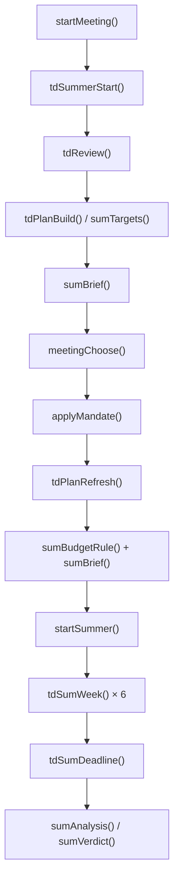

# TD Engine 04 — Mandaatcausaliteit, code-audit (2026-11-20)

**Scope:** `voorzitter-fundering`, alleen statische inspectie. **Geen runtime-tests uitgevoerd.** Dit document is geen PASS-certificaat.

## Causale keten (bestaande code)

## Bevestigde codevolgorde en gevolgen

1. `chairman/meeting.js:startMeeting()` maakt `S.meeting` aan en roept meteen `tdSummerStart()` aan.
2. `club/summer.js:tdSummerStart()` berekent `verdicts=tdReview()`, `tdPlanBuild(verdicts)`, en `sumBrief()`. `tdPlanBuild()` roept `sumTargets()` aan. `sumTargets()` gebruikt onder meer `sumCapOf()`, `marketFor()`, `tdSort()`, `tdSee()`; deze lezen actuele `S.cf.frames`.
3. Pas na de zeven vergaderpijlers wordt `applyMandate()` aangeroepen. Die schrijft de nieuwe `frames`, budget, cap en profiel.
4. `chairman/flow.js:act('mdone')` roept `applyMandate();startSummer()` aan.
5. `startSummer()` roept `tdPlanRefresh()` aan; deze werkt **alleen** `startBudget`, `pool` en `brief` bij, niet `verdicts`, `prios` of `targets`.

**Bevestigde structurele fout:** het definitieve plan kan op het *vorige* mandaat gebaseerd zijn, terwijl het budget en de ondertekende brief het *nieuwe* mandaat gebruiken. Dit raakt vooral `identity` (profiel/leeftijd), `wagehouse` (wage cap), `sales`/regels (verkoopadvies) en mogelijk `risk`/ambitie (budget). Het daadwerkelijke verschil in uitkomsten is nog niet runtime bewezen.

## Causaliteitsmatrix (statische code-inspectie)

| Pijler | Codepad | Verwachte werking | Status |
|---|---|---|---|
| Ambition | `applyMandate` → `AMB_F` / `budgetLeft` | Beschikbaar budget en transferuitvoering | Direct pad; runtime onbewezen |
| Risk | `applyMandate` → cash/debt/budget/cap | Financiële ruimte en schuld | Direct pad; runtime onbewezen |
| Identity | `applyMandate` → `frames.profile` → `tdAges`/`marketFor` | Leeftijd en marktprofiel | **Stale plan-risico bevestigd** |
| Wagehouse | `frames.wagehouse` / `frames.cap` → `sumCapOf` | Salarisfilters | **Stale targets-risico bevestigd** |
| Sales | `frames.sales`, `ruleBlocksSale`, `tdReview` | Verkoopbescherming | **Stale review-risico bevestigd** |
| KPI | `frames.kpi` → `judgeDirector` | Jaarlijkse beoordeling; geen verplichte transferinvloed | Codepad aanwezig |
| Rules | `frames.rules` → `ruleBlocksSale` / `tdRenewals` | Harde beperkingen | Codepad aanwezig; runtime onbewezen |

## Testplan vóór een productiefix

1. Leg state direct vóór `startMeeting()` vast, inclusief seed/RNG, club, TD, selectie, budget en frames.
2. Draai dezelfde state met twee contrasterende mandaten. Vergelijk `sum.verdicts`, `sum.prios`, `sum.prios[].targets`, `sum.brief`, `budgetLeft`.
3. Instrumenteer RNG-draws of gebruik een afzonderlijke RNG-stream voor de markt; *alleen dezelfde seed* is onvoldoende als codepaden verschillende aantallen draws verbruiken.
4. Herhaal over minimaal 20 seeds, test ook tweede zomer, winterwindow en save/load.
5. Beoordeel per pijler regels/constraints, niet alleen of één specifieke speler wordt gekocht.
6. Bouw en voer de bestaande tests en 390px-browserflow uit. Een test die alleen `fails` print maar met exitcode 0 eindigt, telt niet als bewezen groen.

## Voorgestelde minimale reparatie (nog NIET toegepast)

Splits een **voorlopige** TD-review voor de stafstemmen van een **definitief** transferplan na `applyMandate()`. Bouw de definitieve `verdicts`, `prios`, `targets`, `pool` en `brief` opnieuw met het actuele mandaat, zonder bestaande transacties of de UI-flow te dupliceren. Controleer dat de eerste zomer en latere zomers dezelfde regel volgen. Behoud TD-autonomie en bestaande save-compatibiliteit.

## Bewijsstatus

- **CODE-BEVESTIGD:** functievolgorde en onvolledige herberekening.
- **NIET GETEST:** hoeveel mandaatkeuzes daadwerkelijk andere transfers opleveren; regressies; browser/saves.
- **NIET GEWIJZIGD:** productiecode, tests, UI en gegenereerde HTML.
